# academic_niceslides

**English** · [中文](README.zh-CN.md)

academic_niceslides turns a research paper into a talk that does not look AI-made. It is a skill for coding agents (Claude Code, Codex and others) with an engine behind it. The agent writes one semantic source file. The engine renders it in 17 styles and checks the result against fixed rules. You get a single HTML file that presents, edits itself and exports to PDF and PowerPoint.

[Browse all 17 styles ↓](#17-styles)

## Why AI slides look like AI slides, and what this does instead

| Symptom | Cause | What academic_niceslides does |
|---|---|---|
| Tiny all-caps labels above titles, giant numbers, cards | Hierarchy faked with size and decoration | The source file has no field for them, and the checker rejects any text above a title or any number set larger than its sentence |
| Every deck looks the same | Styles are only colour swaps | Each style is a medium (journal plate, Swiss poster, riso print, chalkboard…) with its own rules, written in `styles/<name>/STYLE.md` |
| Numbers that are not in the paper | Charts drawn or retyped by a model | Every number comes from `facts.json`, computed by code; an unregistered number fails the build |
| Paper figures redrawn or "beautified" | Image generation | Figures are taken from the PDF unchanged; only crop, cover and zoom are allowed |
| Everything appears at once | No notion of argument order | Each element can appear on a given click: groups first, then the difference, then the test |

## What you get

- **17 styles in four groups.** *Material*: plate, grid, riso, arch, seal, transit, marker, chalk. *Structure*: rail, chapter, feature. *Circulation*: cite, mono, access. *Venue and identity*: night, fingerprint, kraft. See [`styles/README.md`](styles/README.md) for which to use when.
- **Step-by-step reveals.** Bars, lines, table rows, paragraphs and figure zooms appear on the click you choose. Nothing moves when something appears. The PDF has one page per click, like Beamer overlays.

  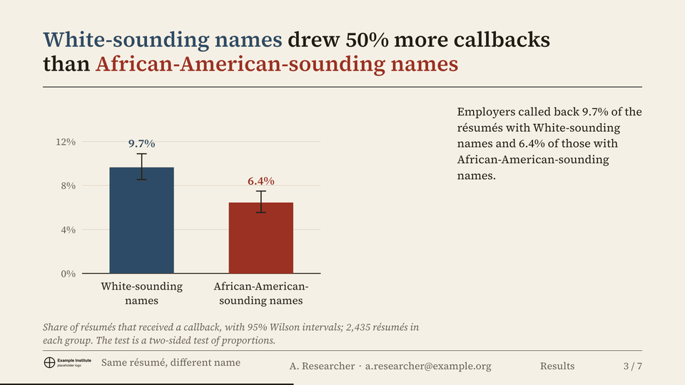
- **Figures from the paper.** `engine/extract.py` takes a figure out of the PDF at 300 dpi and records the page and position. On the slide you can crop it, hide panels you do not discuss, and zoom into one panel on a click.
- **Logos, speaker and email.** Logos appear on the title slide and in the footer. Every content slide's footer carries the short title, speaker, email, section and page number.
- **A built-in editor that works like Google Slides.** Click any text, label, logo, image or chart and a toolbar appears next to it.

  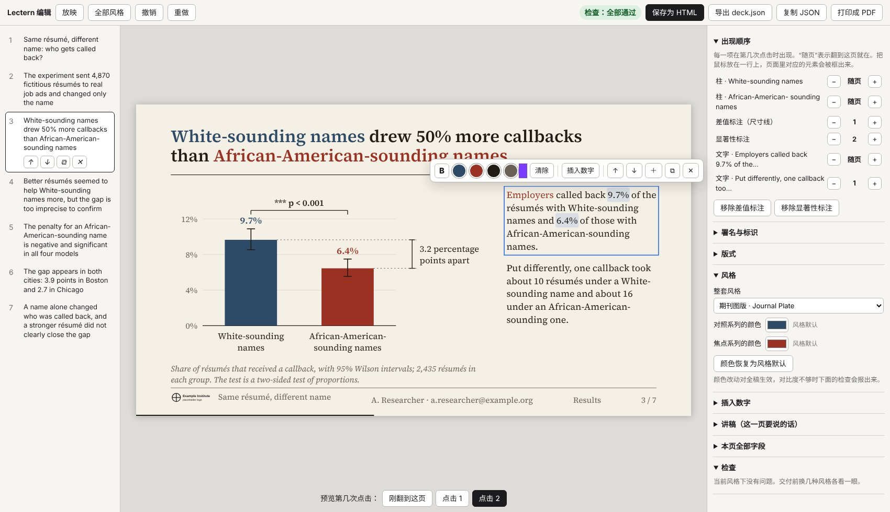
- **Exports.** A PDF with one page per click, and a handout with speaker notes. A PowerPoint file in which text stays editable and logos can be replaced with "Change Picture".

## Install

Send one sentence to your AI agent (Claude Code, Codex, Cursor, or any coding agent that can read files and run commands):

> `Install the academic_niceslides skill from https://github.com/mamingatzu/academic_niceslides`

Modern coding agents can clone the repository, install dependencies, and verify the example automatically.

### Update

Whenever you want to pull the latest version, one sentence to your AI agent is enough:

> `Update academic_niceslides from https://github.com/mamingatzu/academic_niceslides to the latest version.`

### Start a talk

Ask your agent, for example: *"Make a 12-minute conference talk from paper.pdf. My name is …, email …, and these are our logos."*

If you do not specify a style upfront, the agent will list all 17 styles with a link to preview them here and ask whether to follow the default 7-part structure (and whether any section has special requirements) before building.

<details>
<summary>Manual install &amp; update (and technical steps for agents)</summary>

You need Python 3.10+ and Google Chrome (or Chromium).

```bash
git clone https://github.com/mamingatzu/academic_niceslides.git
cd academic_niceslides
pip install -r requirements.txt
python3 -m playwright install chromium   # only if Chrome is not installed; or set ACADEMIC_NICESLIDES_CHROME=/path/to/chrome
```

#### Claude Code

Put the repository where Claude Code looks for skills. The folder name becomes the skill name:

```bash
git clone https://github.com/mamingatzu/academic_niceslides.git ~/.claude/skills/academic_niceslides
pip install -r ~/.claude/skills/academic_niceslides/requirements.txt
```

#### Codex (or any agent that reads AGENTS.md)

Clone the repository anywhere, for example `~/tools/academic_niceslides`. Codex reads [`AGENTS.md`](AGENTS.md), which points it to `SKILL.md`. Open Codex in the folder that holds your paper and say:

> Follow `~/tools/academic_niceslides/SKILL.md` to make a 15-minute talk from `paper.pdf`. Speaker: …, email: …. Logos are in `./logos`.

#### Manual update

```bash
git -C ~/.claude/skills/academic_niceslides pull --ff-only   # or your cloned path
pip install -r ~/.claude/skills/academic_niceslides/requirements.txt
```

The skill is plain Markdown plus Python, so any agent that can read files and run commands can follow it.

</details>

## Try the example

```bash
cd examples/resume
python3 analysis.py              # computes every number into facts.json
python3 make_paper_figure.py     # a stand-in "paper figure" for the demo
cd ../..
python3 engine/build.py examples/resume --open gallery   # → examples/resume/out/deck.html
python3 engine/lint.py  examples/resume                  # every style must print PASS
```

Open `examples/resume/out/deck.html` in a browser. It opens as a gallery of all styles. Click a slide to present it.

## What the agent does with your paper

1. **Confirm style and structure.** If you did not name a template, it proactively lists all 17 styles with the repo preview link so you can see how each looks. It also checks whether to follow the default 7-part structure (**RQ → Gap in Literature → Theory & Hypotheses → Data & Methods → Core Findings (detail) → Contribution → Limitations / Future Study**) and whether you have special requirements for any section (or proceeds directly if none).
2. **Ground.** It writes a small `analysis.py` that puts every number the talk will show into `facts.json`, each with how it was computed. Without data files it registers the published numbers and cites the table and page. Figures are taken from the PDF with `engine/extract.py`.
3. **Storyboard.** It writes `deck.json` following the confirmed structure (with detailed slides for Core Findings): one claim-sentence title per slide, the one piece of evidence, the notes, and the click order. You can ask to approve the titles first.
4. **Build and check.** `build.py` writes `out/deck.html` in your chosen style (or as a gallery of all 17 styles if you ask to compare options). `lint.py` must pass. The agent then looks at the rendered slides and fixes what it sees.
5. **Deliver.** It hands over `out/deck.html` and `out/<style>.pdf`, and a `.pptx` on request.

### The project folder

```
my-talk/
  deck.json        the talk: slides, titles, evidence, click order, notes (the only source)
  facts.json       every number shown, with value, text and how it was computed
  analysis.py      the code that produced facts.json
  assets/          figures extracted from the paper, logos, provenance.json
  out/             deck.html, PDFs, PowerPoint, preview images (generated)
```

## Presenting

Open `out/deck.html`. Everything is in this one file, and it works offline.

| Key | Action |
|---|---|
| → · Space · click | next step, then next slide |
| ← | previous step |
| F | full screen |
| N | speaker notes |
| D | show where every number on this slide comes from |
| S | switch style |
| E | edit |
| G | gallery of all styles |

## Editing after delivery

Press **E** while presenting. Click what you want to change.

| Click | You can |
|---|---|
| Any text | type directly; bold, colour of the comparison series, colour of the focal series, an extra accent, muted grey, clear formatting, insert a registered number |
| A paragraph, step or conclusion | also move up or down, add one below, duplicate, delete |
| A chart label, table header or row label | edit it in a small field; use " / " for a line break |
| Empty space in a chart | swap figure and text, make the figure one column wider or narrower, align the text top, middle or bottom |
| The bar between figure and text | drag it; it snaps to the 12-column grid |
| A logo | replace it, add a version for dark backgrounds, reorder, add another, delete |
| The recurring illustration | replace it with your own image or a figure from the paper, or hide it |
| A figure from the paper | crop and zoom by dragging boxes, replace the image |

The side panel holds the click order of every element, the speaker, email, citation and logos, the colours of the two data series, the speaker notes, and every field of the current slide. Undo and redo are ⌘/Ctrl+Z and ⌘/Ctrl+Shift+Z.

Colours are limited to five roles and positions snap to the grid on purpose. Edited slides stay aligned and keep passing the checks, and if you switch style later the same word takes the new style's colour for its role.

**Saving.** *Save as HTML* gives a new self-contained file you can send to a co-author. *Export deck.json* gives the source back. Put that file in the project folder and run `build.py` again; images you uploaded in the editor travel inside it and are unpacked into `assets/uploads/`.

## PowerPoint and PDF

```bash
python3 engine/render.py      <project> <style> --handout   # PDF (one page per click), handout with notes, preview sheets
python3 engine/export_pptx.py <project> --style <style>     # out/<style>.pptx and out/fonts/
python3 engine/export_pptx.py <project> --style <style> --pages   # one PowerPoint slide per click instead of animations
```

In the PowerPoint file, all text is native and editable. Logos and the recurring illustration are separate pictures named "Logo 1" and "Anchor image", so you can right-click and choose "Change Picture". Step-by-step reveals become native "Appear on click" animations, and speaker notes go into the notes pane. Charts and paper figures are pictures. Install the fonts in `out/fonts/` before opening the file, or PowerPoint will substitute another typeface.

PowerPoint is a one-way exit: changes made there do not flow back into `deck.json`. Make lasting changes in the built-in editor.

## The checks

`engine/lint.py` runs on the rendered slides, in every style, and fails the build on any of these:

| Rule | Fails when |
|---|---|
| `min-size` | any text is under 14 pt (figures from the paper: 12 pt) |
| `giant` · `stat-callout` | text is larger than the title, or a number is larger than its sentence |
| `eyebrow` | anything sits above the title |
| `fragment` · `assertion` · `title-lines` | a text block has fewer than five words, a title is not a sentence, or a title runs past two lines |
| `one-family` | a second typeface appears |
| `provenance` | a number on the slide has no registered source |
| `overflow` · `overlap` · `label-collision` · `contrast` | something leaves the slide, overlaps, collides inside a chart, or is too faint to read |
| `step-gap` · `logo-*` · `figure-*` | a click reveals nothing, a logo is misplaced or stretched, or a paper figure has no source or is too small to read |

## Repository layout

```
SKILL.md          entry point for the agent
AGENTS.md         pointer for Codex and other agents
PRESENTER.md      the shared method: source format, reveals, logos, figures, editing, PowerPoint, checks
engine/           build.py · lint.py · render.py · export_pptx.py · extract.py · js/ · base.css
styles/<name>/    STYLE.md · style.css · style.json · fonts/
examples/resume/  the example project
docs/             images for this README
```

## Add a style

Copy `styles/_template/`. Write its `STYLE.md` first (nine sections: what the medium is, paper and ink, colour logic, type, shape grammar, chart strokes, native moves, pitfalls, what may change). Then write the CSS and put the font files in `fonts/`. A style is accepted when its contact sheet is recognisable at thumbnail size, `lint.py` passes, and neither `engine/base.css` nor the chart code was changed.

## 17 styles

Each GIF cycles through all 7 slides. Open the full deck overview to see all slides at once.

### 1. Journal Plate

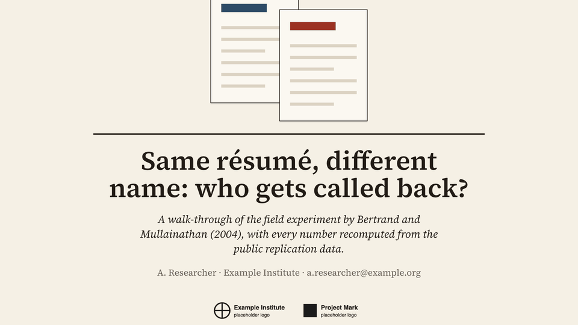

[View all 7 slides](docs/styles/plate-all.jpg) · [STYLE.md](styles/plate/STYLE.md)

### 2. Swiss Grid

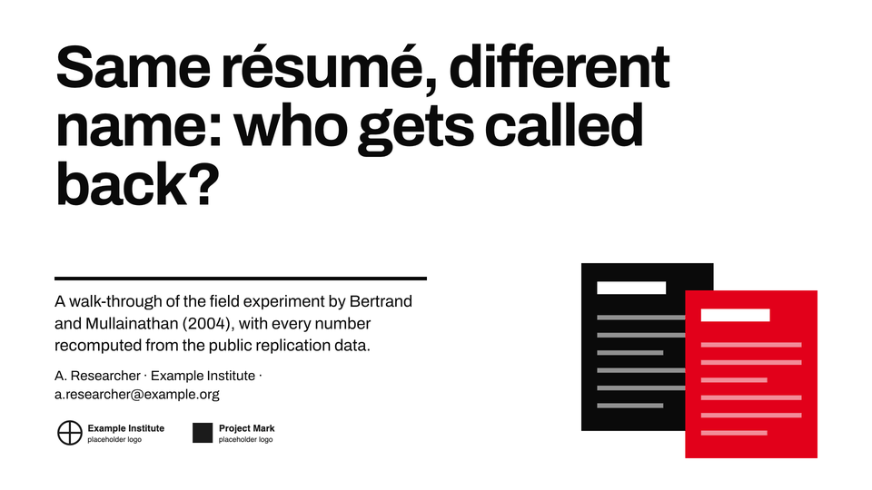

[View all 7 slides](docs/styles/grid-all.jpg) · [STYLE.md](styles/grid/STYLE.md)

### 3. Two-ink Riso

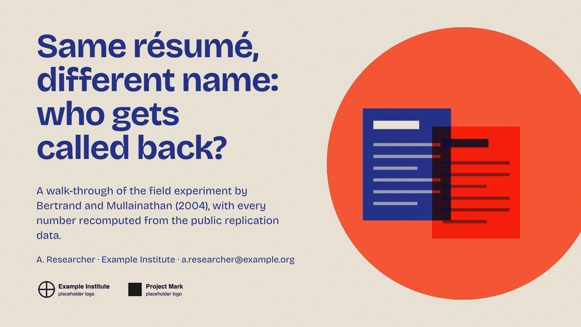

[View all 7 slides](docs/styles/riso-all.jpg) · [STYLE.md](styles/riso/STYLE.md)

### 4. Mid-century Arch

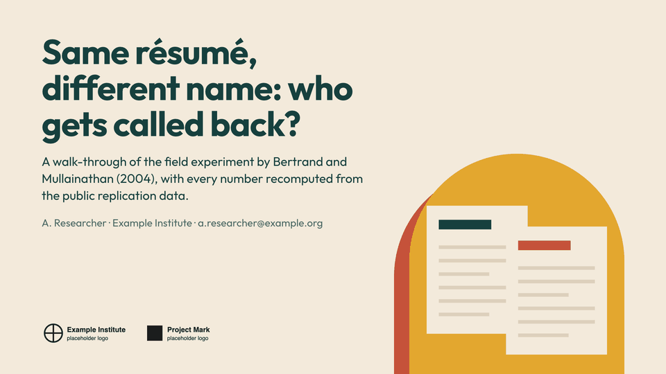

[View all 7 slides](docs/styles/arch-all.jpg) · [STYLE.md](styles/arch/STYLE.md)

### 5. Ink and Seal

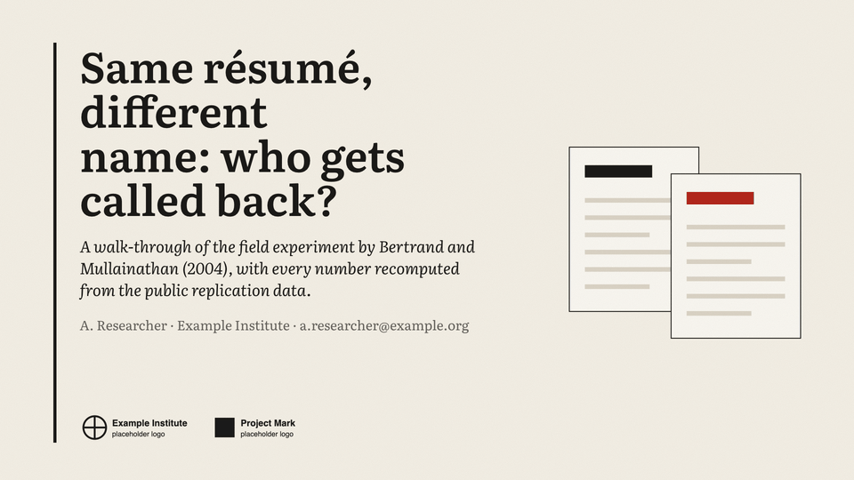

[View all 7 slides](docs/styles/seal-all.jpg) · [STYLE.md](styles/seal/STYLE.md)

### 6. Transit Map

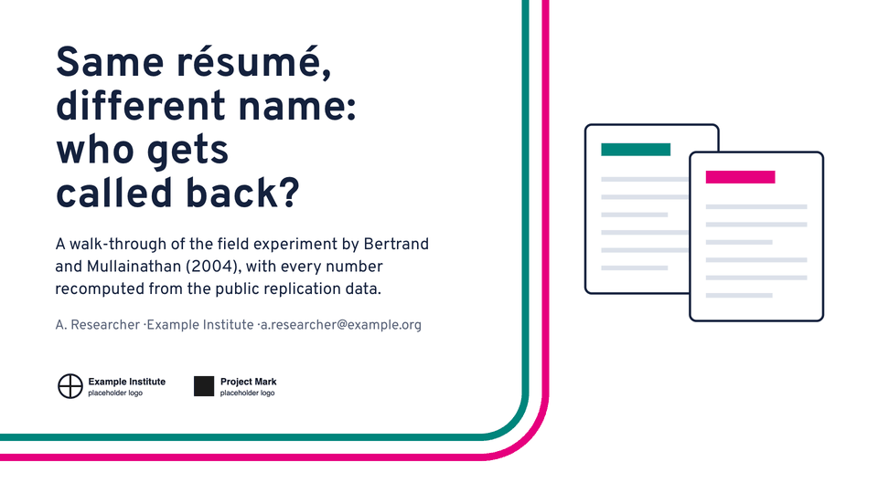

[View all 7 slides](docs/styles/transit-all.jpg) · [STYLE.md](styles/transit/STYLE.md)

### 7. Highlighter

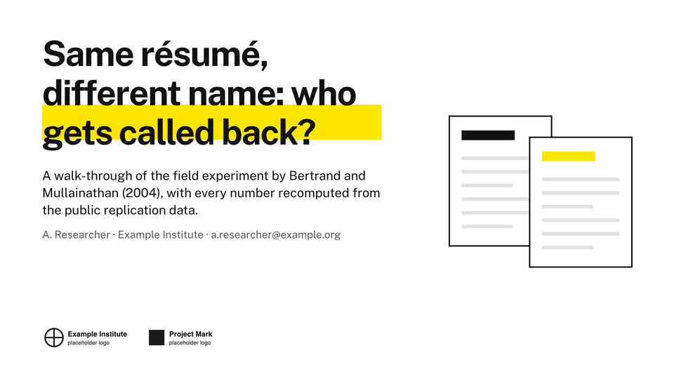

[View all 7 slides](docs/styles/marker-all.jpg) · [STYLE.md](styles/marker/STYLE.md)

### 8. Chalkboard

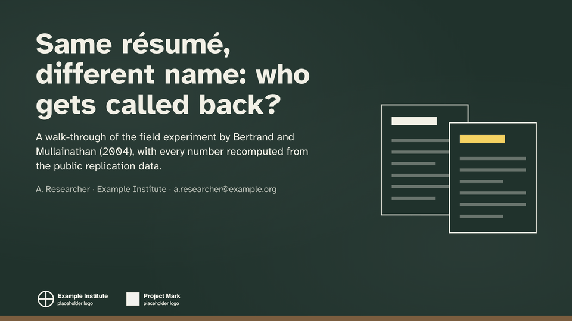

[View all 7 slides](docs/styles/chalk-all.jpg) · [STYLE.md](styles/chalk/STYLE.md)

### 9. Outline Rail

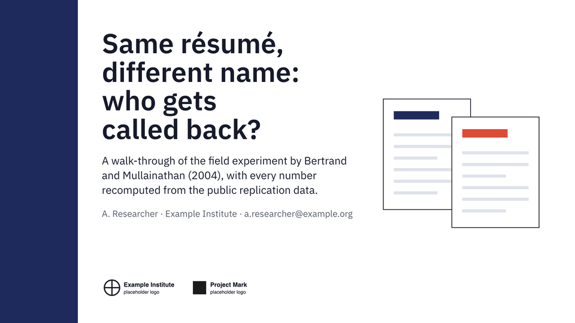

[View all 7 slides](docs/styles/rail-all.jpg) · [STYLE.md](styles/rail/STYLE.md)

### 10. Chapter Colour

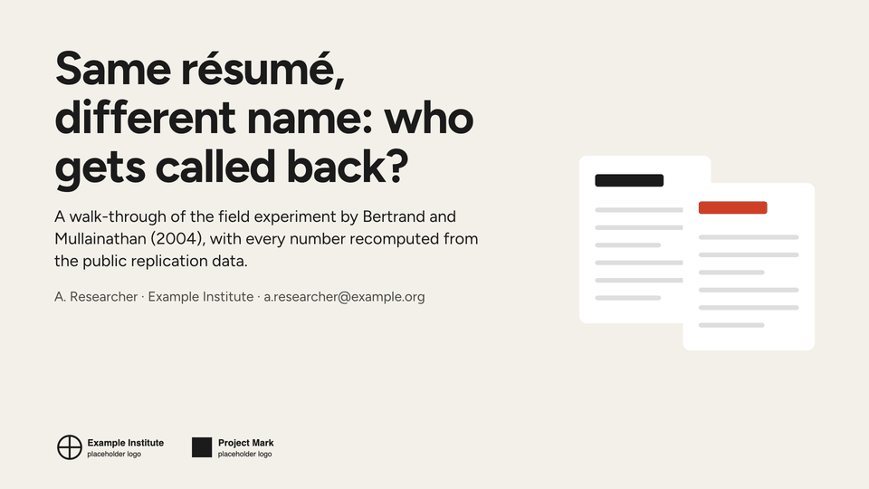

[View all 7 slides](docs/styles/chapter-all.jpg) · [STYLE.md](styles/chapter/STYLE.md)

### 11. Side Title

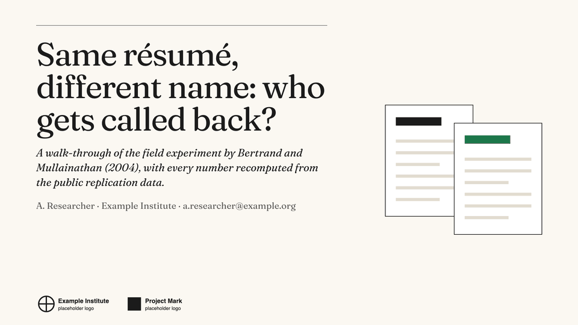

[View all 7 slides](docs/styles/feature-all.jpg) · [STYLE.md](styles/feature/STYLE.md)

### 12. Citation Card

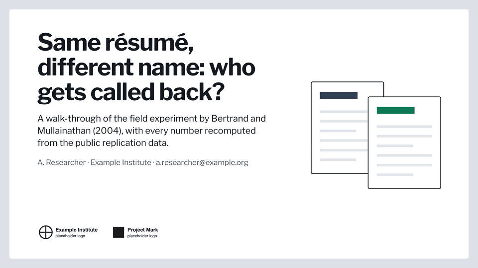

[View all 7 slides](docs/styles/cite-all.jpg) · [STYLE.md](styles/cite/STYLE.md)

### 13. One Ink

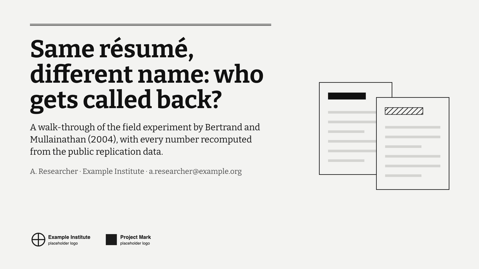

[View all 7 slides](docs/styles/mono-all.jpg) · [STYLE.md](styles/mono/STYLE.md)

### 14. Large Print

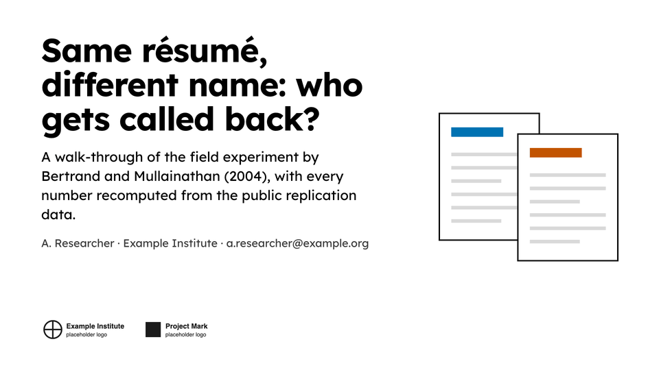

[View all 7 slides](docs/styles/access-all.jpg) · [STYLE.md](styles/access/STYLE.md)

### 15. Night Hall


[View all 7 slides](docs/styles/night-all.jpg) · [STYLE.md](styles/night/STYLE.md)

### 16. Data Fingerprint

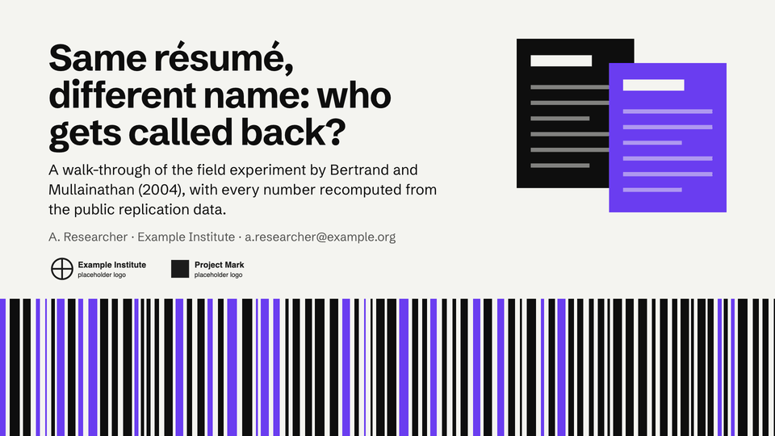

[View all 7 slides](docs/styles/fingerprint-all.jpg) · [STYLE.md](styles/fingerprint/STYLE.md)

### 17. Kraft and White Ink

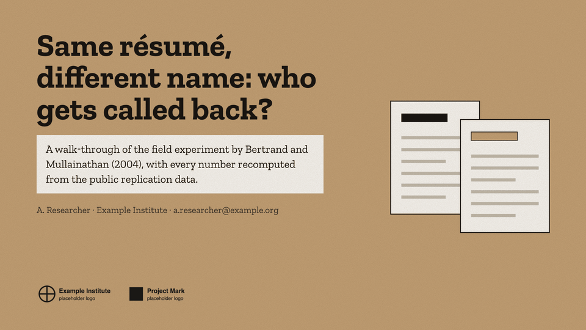

[View all 7 slides](docs/styles/kraft-all.jpg) · [STYLE.md](styles/kraft/STYLE.md)

## Credits

academic_niceslides is released under the [MIT License](LICENSE). Third-party fonts and example data keep their own licenses; see [NOTICE.md](NOTICE.md).

Thanks to [Lemo-Opuscar](https://github.com/lemomo-ai/lemo-opuscar) for some of the ideas behind this project.

The example uses the replication data of Bertrand & Mullainathan (2004). The fonts are open-source typefaces under the SIL Open Font License. See [NOTICE.md](NOTICE.md).
