# academic_niceslides

[English](README.md) · **中文**

academic_niceslides 把一篇论文变成一场没有“AI 味”的学术报告。它是给编程 agent（Claude Code、Codex 等）用的 skill，背后带一个引擎：agent 只写一份语义源文件，引擎把它渲染成 17 种风格，并按固定规则逐页检查。成品是一个 HTML 文件，能放映、能自己编辑，也能导出 PDF 和 PowerPoint。

[查看全部 17 种风格 ↓](#17-种风格)

## AI 做的幻灯片为什么一股 AI 味，这里怎么解决

| 症状 | 原因 | academic_niceslides 的做法 |
|---|---|---|
| 标题上方的全大写小标签、超大数字、卡片 | 没有构图，只能靠尺寸和装饰硬造层级 | 源文件里没有这些字段；检查器拦下标题上方的任何文字，以及比所在句子更大的数字 |
| 每份都长得一样 | 所谓风格只是换配色 | 每种风格是一种媒介（期刊图版、瑞士海报、孔版印刷、黑板……），规则写在 `styles/<名字>/STYLE.md` |
| 出现论文里没有的数字 | 图表由模型画或手打 | 每个数字都来自代码算出的 `facts.json`，引用不到就构建失败 |
| 论文原图被重画或“美化” | 图片生成 | 原图从 PDF 原样取出，只允许裁切、遮挡和放大 |
| 内容一股脑全部出现 | 没有论证顺序 | 每个元素可以指定第几次点击出现：先出两组，再出差值，最后出检验结果 |

## 能做什么

- **17 种风格，分四组。** 材质：期刊图版、瑞士网格、双色孔版、中古拱形、宣纸朱印、线路图、荧光笔、黑板。结构：侧栏纲要、章节色、侧题特稿。传播：署名卡、单色墨、无障碍大字。场地与身份：夜场、数据指纹、牛皮纸。什么场合用哪种，见 [`styles/README.md`](styles/README.md)。
- **逐步呈现。** 柱、线、表格行、段落和原图放大，都可以指定在第几次点击出现；元素出现时版面不跳动。PDF 每次点击一页，相当于 Beamer 的 overlay。

  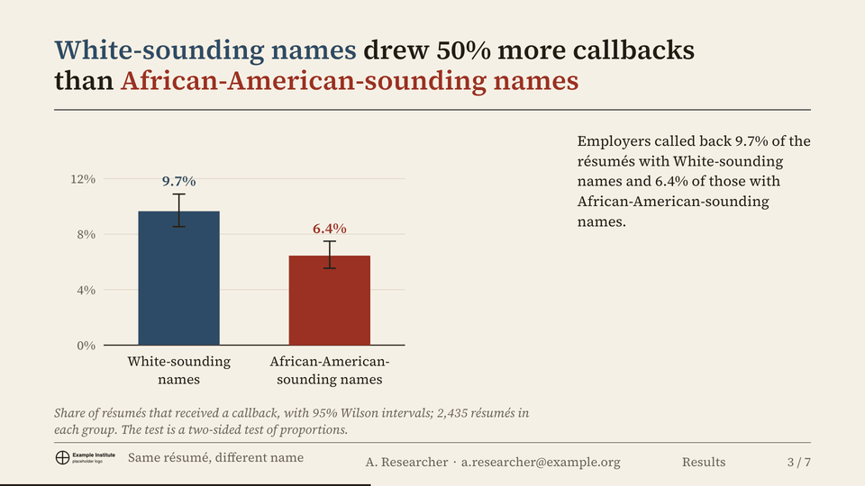
- **论文原图。** `engine/extract.py` 按页码和位置从 PDF 取图（300 dpi），同时记下出处。上了幻灯片可以裁切、遮掉不讲的格子，点击后放大到某一格。
- **logo、讲者和邮箱。** logo 放在扉页和页脚；每一页内容页的页脚有短标题、讲者、邮箱、章节和页码。
- **像 Google Slides 一样的内置编辑器。** 点任何文字、标签、logo、图片或图表，旁边就弹出它自己的工具条。

  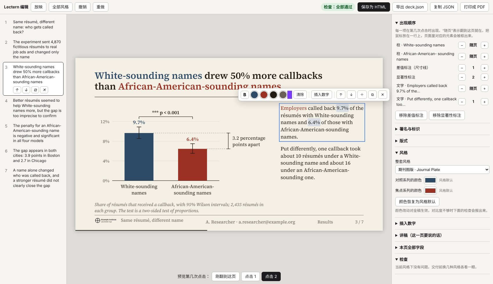
- **导出。** PDF（每次点击一页）、带讲稿的讲义；PowerPoint 里文字可以直接改，logo 可以右键“更改图片”。

## 安装

最简便的方式是直接发一句话给你的 AI agent（Claude Code、Codex、Cursor 等），现在 AI agent 可以直接帮你完成克隆、装依赖和验证：

> `帮我安装 academic_niceslides：https://github.com/mamingatzu/academic_niceslides`

### 更新

后续需要更新到最新版本时，同样发一句话给你的 AI agent 即可：

> `帮我把 academic_niceslides 更新到最新版本（https://github.com/mamingatzu/academic_niceslides）`

### 开始做报告

例如直接对 agent 说：*“用 paper.pdf 做一个 12 分钟的会议报告。讲者是……，邮箱……，这是我们的 logo。”*

如果你没有提前指定模板，agent 会主动列出全部 17 种模板名称并附上仓库预览链接，同时向你确认是否采用默认七段式结构以及各部分有无特殊要求，没特殊要求就直接开始制作。

<details>
<summary>手动安装与更新（同时供 Agent 参考）</summary>

需要 Python 3.10+ 和 Google Chrome（或 Chromium）。

```bash
git clone https://github.com/mamingatzu/academic_niceslides.git
cd academic_niceslides
pip install -r requirements.txt
python3 -m playwright install chromium   # 没装 Chrome 时才需要；也可以设 ACADEMIC_NICESLIDES_CHROME=/Chrome 的路径
```

#### 在 Claude Code 里用

把仓库放进 Claude Code 读取 skill 的文件夹，文件夹名就是 skill 名：

```bash
git clone https://github.com/mamingatzu/academic_niceslides.git ~/.claude/skills/academic_niceslides
pip install -r ~/.claude/skills/academic_niceslides/requirements.txt
```

#### 在 Codex（或任何读 AGENTS.md 的 agent）里用

把仓库克隆到任意位置，比如 `~/tools/academic_niceslides`。Codex 会读 [`AGENTS.md`](AGENTS.md)，它会指向 `SKILL.md`。在放论文的文件夹里打开 Codex，然后说：

> 按 `~/tools/academic_niceslides/SKILL.md` 用 `paper.pdf` 做一个 15 分钟的报告。讲者：……，邮箱：……。logo 在 `./logos`。

#### 手动更新

```bash
git -C ~/.claude/skills/academic_niceslides pull --ff-only   # 或替换为你的克隆路径
pip install -r ~/.claude/skills/academic_niceslides/requirements.txt
```

skill 只是 Markdown 加 Python，任何能读文件、能运行命令的 agent 都能照着做。

</details>

## 先跑一遍样例

```bash
cd examples/resume
python3 analysis.py              # 把每个数字算进 facts.json
python3 make_paper_figure.py     # 生成一张演示用的“论文图”
cd ../..
python3 engine/build.py examples/resume --open gallery   # → examples/resume/out/deck.html
python3 engine/lint.py  examples/resume                  # 每种风格都应显示 PASS
```

用浏览器打开 `examples/resume/out/deck.html`，先看到所有风格的画廊，点任意一页开始放映。

## agent 拿到论文后做什么

1. **确认风格与结构。** 如果你没有指定模板，agent 会主动列出全部 17 种风格名称，并附上仓库预览链接方便你查看效果；同时确认是否遵循默认七段式结构（**研究问题 RQ → 文献缺口 Gap in Literature → 理论与假设 Theory & Hypotheses → 数据与方法 Data & Methods → 核心发现（详述 Core Findings）→ 研究贡献 Contribution → 局限与未来研究 Limitations / Future Study**），以及对各部分有没有特殊要求，没有的话就直接推进。
2. **取证。** 写一个小的 `analysis.py`，把报告要出现的每个数字算进 `facts.json`，并写明怎么算的。没有数据文件时，就登记论文发表的数字，并注明表号和页码。论文里的图用 `engine/extract.py` 取出。
3. **故事板。** 按确认好的结构写 `deck.json`（重点展开核心发现）：每页一句结论式标题、唯一的证据、讲解文字和点击顺序。你可以要求先审标题。
4. **构建与检查。** `build.py` 按选定风格生成 `out/deck.html`（如果你要求先比较效果，也可以用画廊模式同时预览全部风格），`lint.py` 必须全部通过；然后 agent 自己看渲染出来的页面，修一轮。
5. **交付。** `out/deck.html` 和 `out/<风格>.pdf`；需要时再给 `.pptx`。

### 一个报告的项目文件夹

```
my-talk/
  deck.json        报告本身：页面、标题、证据、点击顺序、讲稿（唯一的源头）
  facts.json       页面上出现的每个数字：数值、显示文本、算法
  analysis.py      生成 facts.json 的代码
  assets/          从论文取出的图、logo、provenance.json
  out/             deck.html、PDF、PowerPoint、预览图（生成的）
```

## 放映

打开 `out/deck.html`。所有东西都在这一个文件里，离线也能用。

| 按键 | 作用 |
|---|---|
| → · 空格 · 点击 | 下一步，然后下一页 |
| ← | 上一步 |
| F | 全屏 |
| N | 讲稿 |
| D | 显示本页每个数字是怎么算出来的 |
| S | 换风格 |
| E | 编辑 |
| G | 所有风格的画廊 |

## 交付后怎么改

放映时按 **E**，点你想改的东西：

| 点什么 | 能做什么 |
|---|---|
| 任何文字 | 直接打字；加粗、对照系列色、焦点系列色、强调色、次要灰、清除格式、插入登记过的数字 |
| 一段正文、步骤或结论 | 另外可以上移、下移、在下面加一段、复制、删除 |
| 图表标签、表头、表格行名 | 在小输入框里改，“ / ”表示换行 |
| 图表空白处 | 图文对调、图宽一栏或窄一栏、文字靠上、居中或靠下 |
| 图和文字之间的竖条 | 左右拖动，按 12 栏网格吸附 |
| logo | 换图片、加深色背景用的版本、调顺序、再加一个、删除 |
| 贯穿全稿的示意图 | 换成自己的图片或论文里的某张图，或者不显示 |
| 论文原图 | 拖框裁切和放大、换图片 |

右侧面板里有每个元素的出现顺序、讲者、邮箱、出处与 logo、两组数据的颜色、讲稿，以及本页的全部字段。撤销和重做是 ⌘/Ctrl+Z 和 ⌘/Ctrl+Shift+Z。

颜色只开放五种角色、位置按网格吸附，是有意的：改完的页面仍然对齐、仍然通过检查；之后换风格，同一个词也会自动换成新风格里那个角色的颜色。

**保存。** “保存为 HTML”得到一个新的自包含文件，可以直接发给合作者接着改；“导出 deck.json”把源文件交还出来。把它放回项目文件夹再运行一次 `build.py`，编辑器里上传的图片会随文件一起带回，自动解包到 `assets/uploads/`。

## PowerPoint 和 PDF

```bash
python3 engine/render.py      <项目> <风格> --handout     # PDF（每次点击一页）、带讲稿的讲义、预览图
python3 engine/export_pptx.py <项目> --style <风格>       # out/<风格>.pptx 和 out/fonts/
python3 engine/export_pptx.py <项目> --style <风格> --pages   # 不用动画，改成每次点击一张幻灯片
```

PowerPoint 文件里，所有文字都是原生文本框，可以直接改。logo 和示意图是单独的图片，名字是“Logo 1”和“Anchor image”，右键“更改图片”就能换。逐步呈现是原生的“单击时出现”动画，讲稿在备注里。图表和论文原图是图片。打开前先安装 `out/fonts/` 里的字体，否则 PowerPoint 会换成别的字体。

PowerPoint 是单向出口：在里面做的修改回不到 `deck.json`。需要长期保留的修改，请在内置编辑器里做。

## 检查规则

`engine/lint.py` 对每种风格渲染后的页面逐条检查，任何一条不过就构建失败：

| 规则 | 什么时候失败 |
|---|---|
| `min-size` | 任何文字小于 14 pt（论文原图里的字：12 pt） |
| `giant` · `stat-callout` | 文字比标题大，或数字比它所在的句子大 |
| `eyebrow` | 标题上方有任何东西 |
| `fragment` · `assertion` · `title-lines` | 文字块少于 5 个词、标题不是整句、标题超过两行 |
| `one-family` | 出现第二种字体 |
| `provenance` | 页面上的数字没有登记来源 |
| `overflow` · `overlap` · `label-collision` · `contrast` | 出界、压叠、图内标签相撞、对比度不足 |
| `step-gap` · `logo-*` · `figure-*` | 某次点击什么都没出现、logo 位置不对或被拉伸、原图没有出处或太小看不清 |

## 仓库结构

```
SKILL.md          agent 的入口
AGENTS.md         给 Codex 等 agent 的指引
PRESENTER.md      所有风格共用的方法：源文件格式、逐步呈现、logo、原图、编辑、PowerPoint、检查
engine/           build.py · lint.py · render.py · export_pptx.py · extract.py · js/ · base.css
styles/<名字>/    STYLE.md · style.css · style.json · fonts/
examples/resume/  样例项目
docs/             README 用的图片
```

## 加一种新风格

复制 `styles/_template/`。先写 `STYLE.md`，共九节：这是什么媒介、纸与墨、颜色逻辑、字体、形状文法、图表笔触、原生手法、媒介陷阱、可变空间。再写 CSS，字体文件放进 `fonts/`。验收标准：缩略图尺寸下能一眼认出来，`lint.py` 全部通过，且没有改动 `engine/base.css` 和图表代码。

## 17 种风格

每种 GIF 循环展示全部 7 页。点击「查看全部 7 页」打开静态总览。

### 1. 期刊图版

象牙纸上的学术专著：衬线、发丝线、图版与边注。

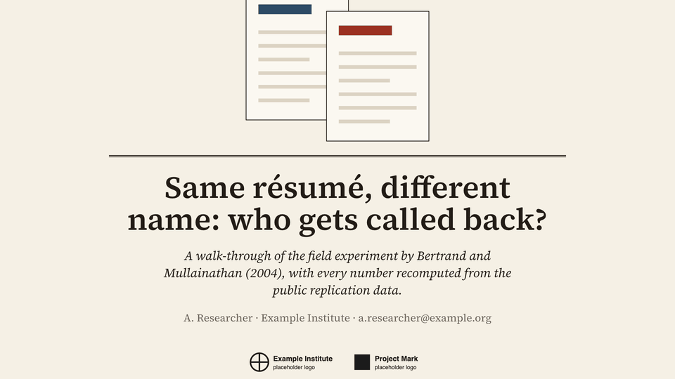

[查看全部 7 页](docs/styles/plate-all.jpg) · [STYLE.md](styles/plate/STYLE.md)

### 2. 瑞士网格

白底、黑与一只红：粗体左对齐，一切挂在同一条横线上。

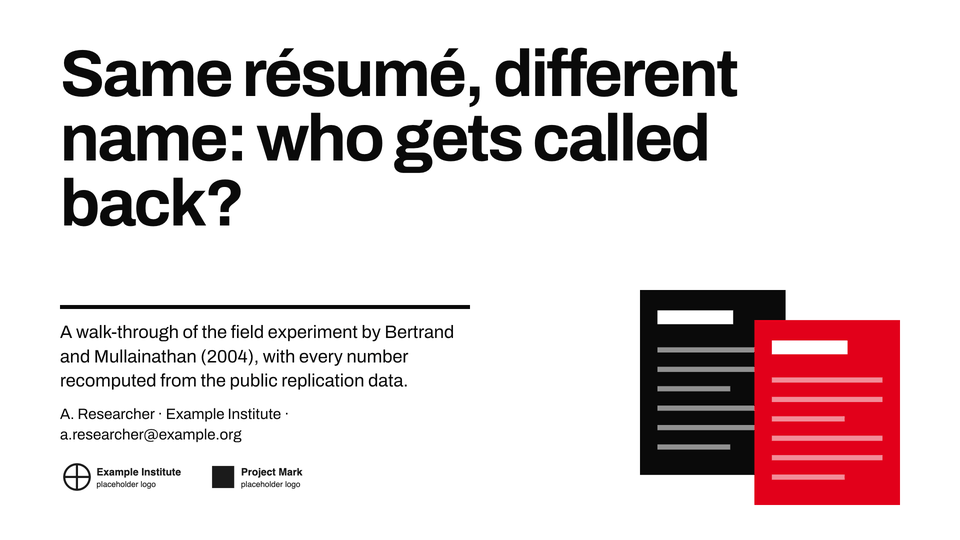

[查看全部 7 页](docs/styles/grid-all.jpg) · [STYLE.md](styles/grid/STYLE.md)

### 3. 双色孔版

米色纸上只印两只墨：蓝与橙，叠印处出现第三色。

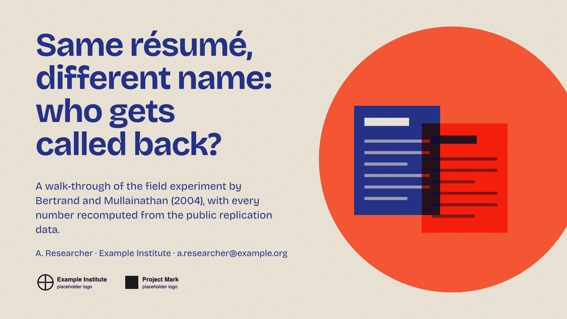

[查看全部 7 页](docs/styles/riso-all.jpg) · [STYLE.md](styles/riso/STYLE.md)

### 4. 中古拱形

奶油底上三只颜色和一个拱形，重复到底。

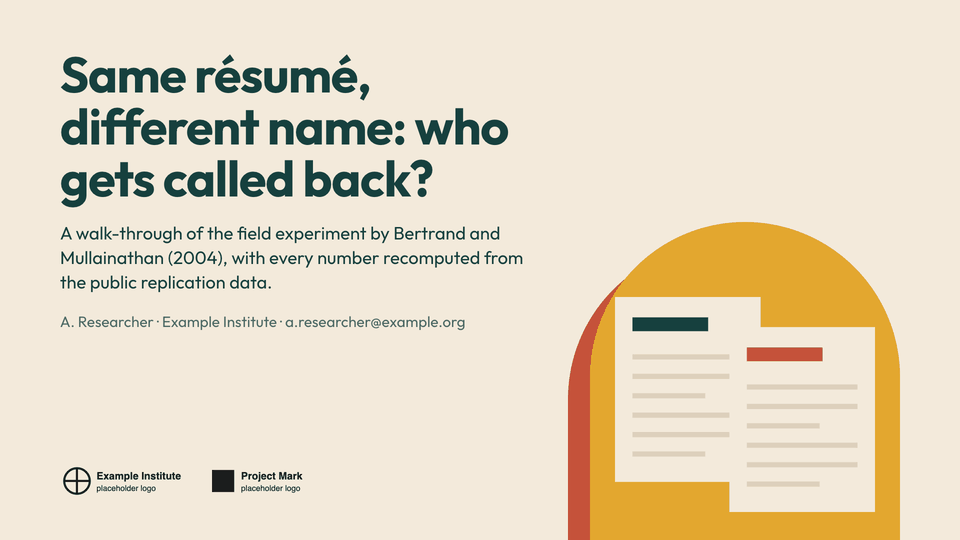

[查看全部 7 页](docs/styles/arch-all.jpg) · [STYLE.md](styles/arch/STYLE.md)

### 5. 宣纸朱印

宣纸、墨色和一方朱砂印：页码盖在印里。

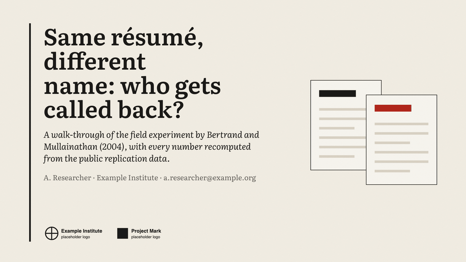

[查看全部 7 页](docs/styles/seal-all.jpg) · [STYLE.md](styles/seal/STYLE.md)

### 6. 线路图

白底上的两条线路：步骤是站点，进度是线路图。

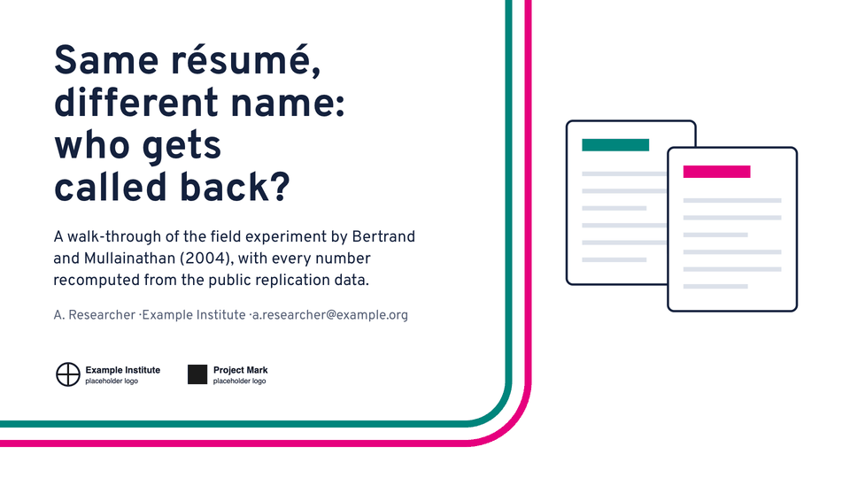

[查看全部 7 页](docs/styles/transit-all.jpg) · [STYLE.md](styles/transit/STYLE.md)

### 7. 荧光笔

白纸黑字，只有一支黄色荧光笔负责强调。

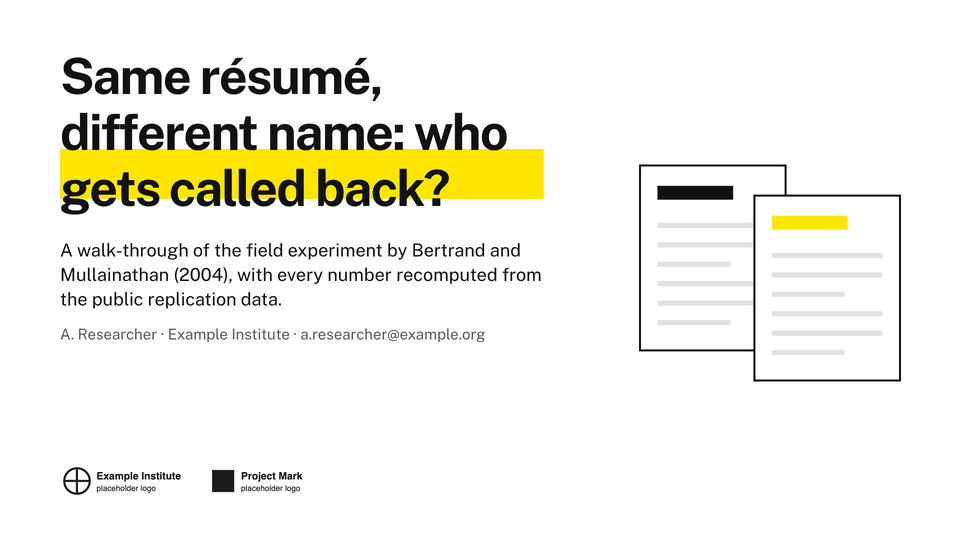

[查看全部 7 页](docs/styles/marker-all.jpg) · [STYLE.md](styles/marker/STYLE.md)

### 8. 黑板

深绿黑板上的白粉笔和一支黄粉笔，唯一的深色风格。

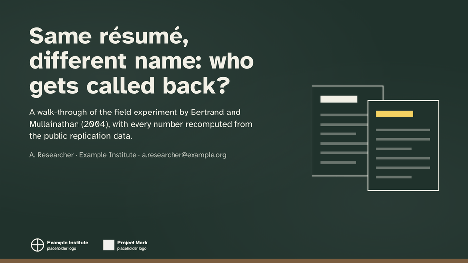

[查看全部 7 页](docs/styles/chalk-all.jpg) · [STYLE.md](styles/chalk/STYLE.md)

### 9. 侧栏纲要

左侧一条色栏写着全部章节，讲到哪一章哪一章就亮。Beamer 的侧栏导航，重做一遍。

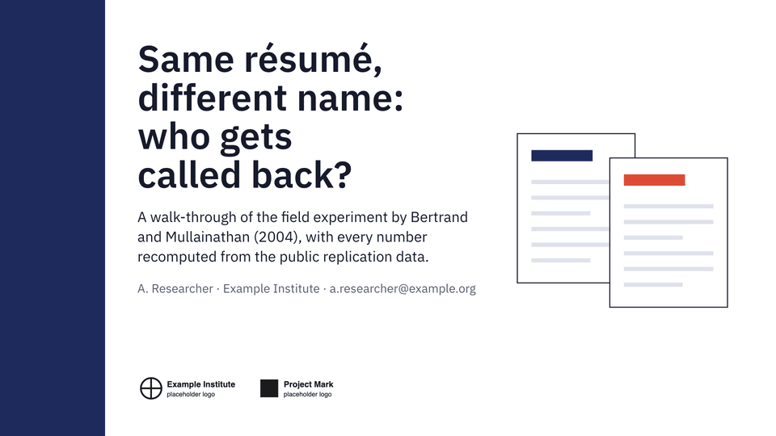

[查看全部 7 页](docs/styles/rail-all.jpg) · [STYLE.md](styles/rail/STYLE.md)

### 10. 章节色

每一章一种底色，翻页时底色一变，听众就知道进入了下一章。

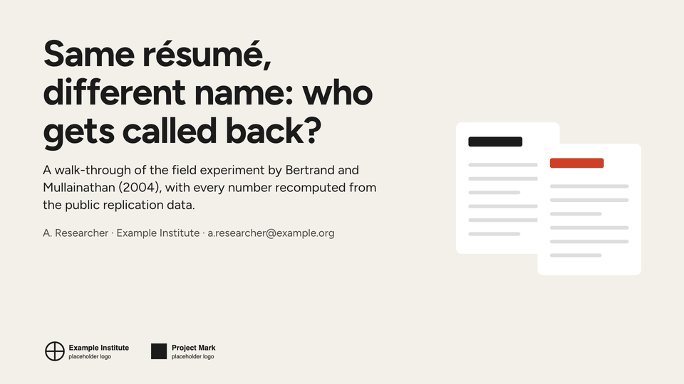

[查看全部 7 页](docs/styles/chapter-all.jpg) · [STYLE.md](styles/chapter/STYLE.md)

### 11. 侧题特稿

标题在左栏从上往下排，右边整块留给图。适合宽屏，也适合会后当文章读。

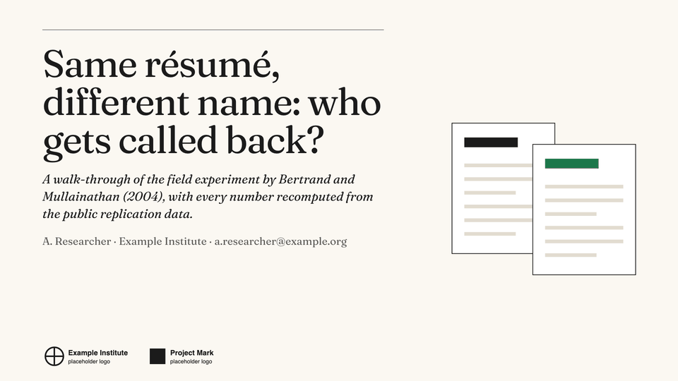

[查看全部 7 页](docs/styles/feature-all.jpg) · [STYLE.md](styles/feature/STYLE.md)

### 12. 署名卡

每一页都带完整出处，四周留足安全边。被截图、被转发之后仍然知道出自哪篇论文。


[查看全部 7 页](docs/styles/cite-all.jpg) · [STYLE.md](styles/cite/STYLE.md)

### 13. 单色墨

只有一种墨。两组数据靠实心与斜线、实线与虚线区分，黑白打印、复印、电子墨水屏都不丢信息。

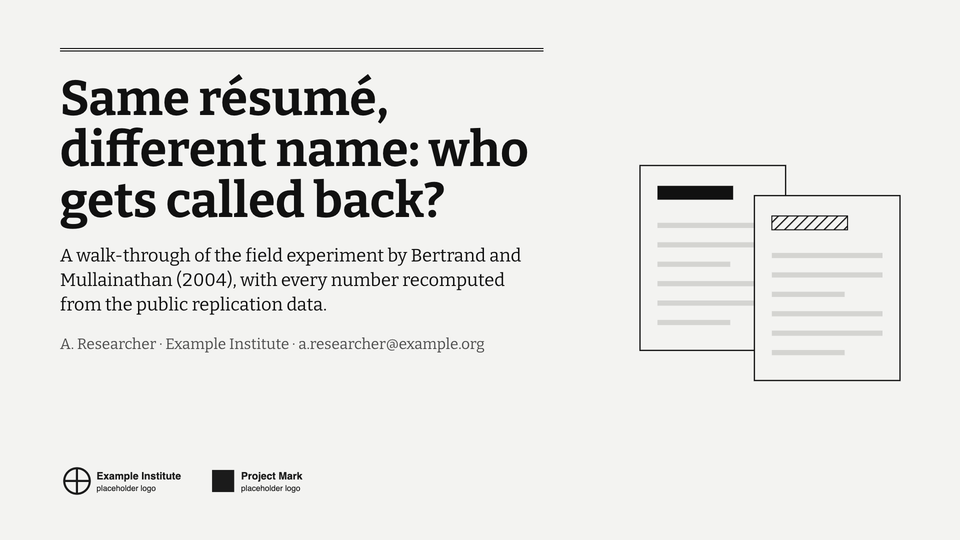

[查看全部 7 页](docs/styles/mono-all.jpg) · [STYLE.md](styles/mono/STYLE.md)

### 14. 无障碍大字

最小字号和图内文字上调一档，颜色用色盲友好的蓝与橙，再叠一层图案，后排和色觉障碍的听众都读得出。

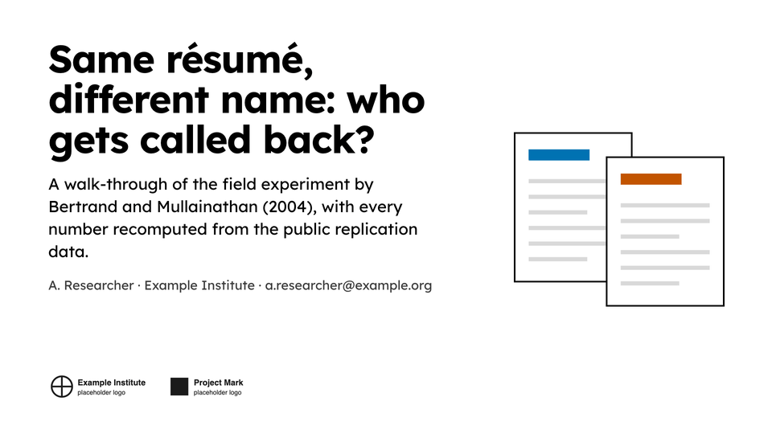

[查看全部 7 页](docs/styles/access-all.jpg) · [STYLE.md](styles/access/STYLE.md)

### 15. 夜场

深蓝黑的大厅用色：暖白文字，一只琥珀色只给焦点。


[查看全部 7 页](docs/styles/night-all.jpg) · [STYLE.md](styles/night/STYLE.md)

### 16. 数据指纹

页面底部的条纹由这篇论文自己的数字算出来，换一篇论文就换一副条纹；它同时是进度条。

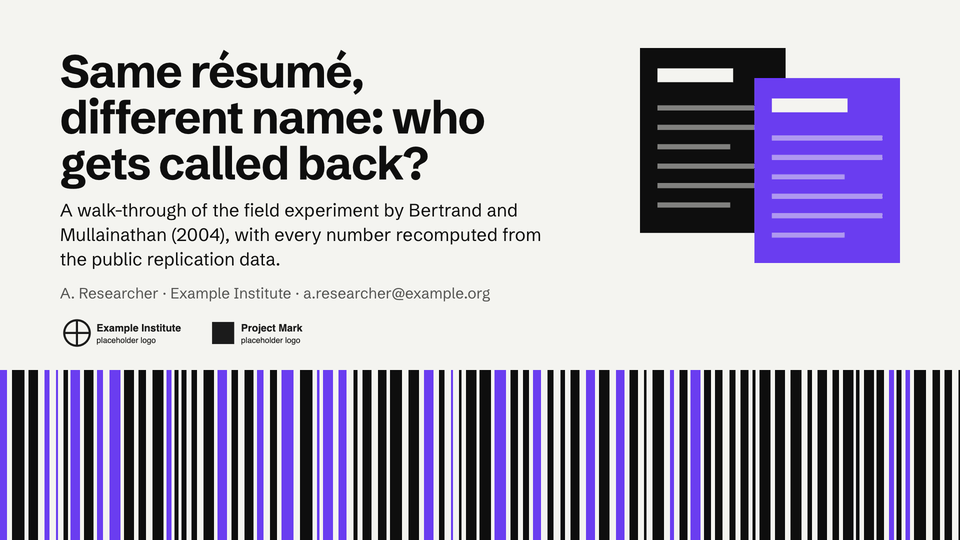

[查看全部 7 页](docs/styles/fingerprint-all.jpg) · [STYLE.md](styles/fingerprint/STYLE.md)

### 17. 牛皮纸

牛皮纸上的黑墨和白墨。焦点系列用白墨，关键词贴白色标签。

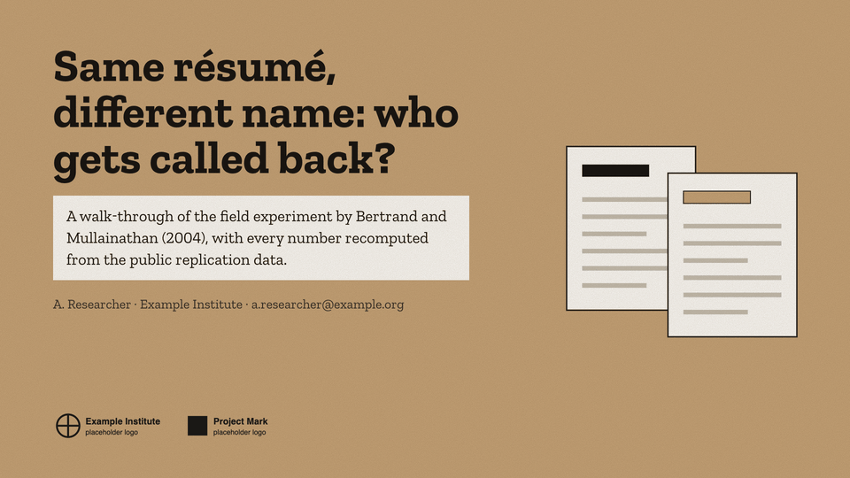

[查看全部 7 页](docs/styles/kraft-all.jpg) · [STYLE.md](styles/kraft/STYLE.md)

## 致谢

academic_niceslides 采用 [MIT 许可证](LICENSE)。第三方字体和示例数据保留各自的许可证；详见 [NOTICE.md](NOTICE.md)。

感谢 [Lemo-Opuscar](https://github.com/lemomo-ai/lemo-opuscar) 提供的一些思路。

样例使用 Bertrand & Mullainathan (2004) 的公开复制数据。字体为 SIL Open Font License 许可的开源字体。详见 [NOTICE.md](NOTICE.md)。
